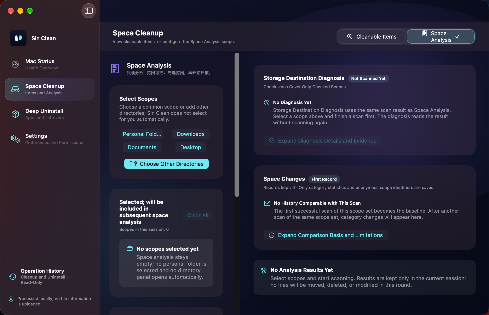
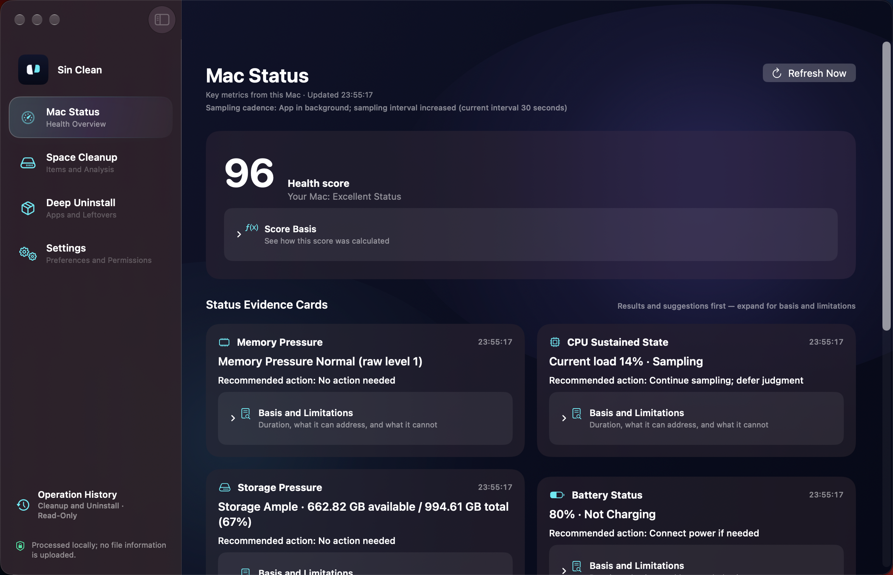
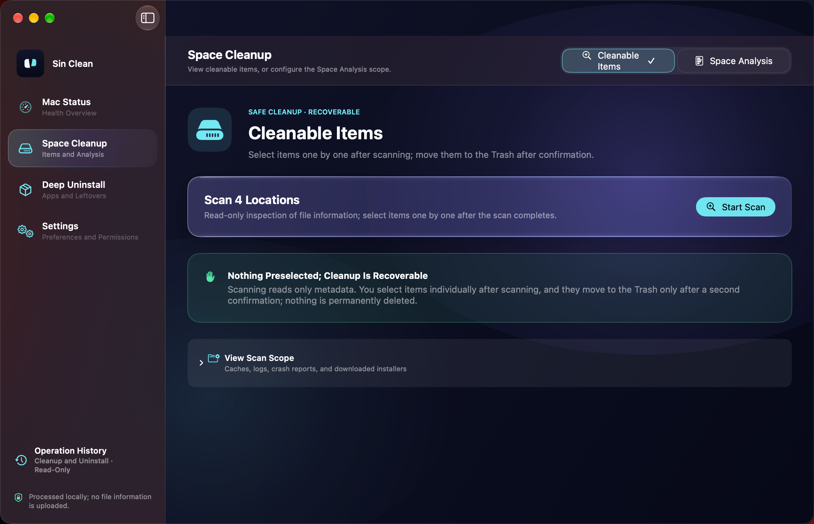
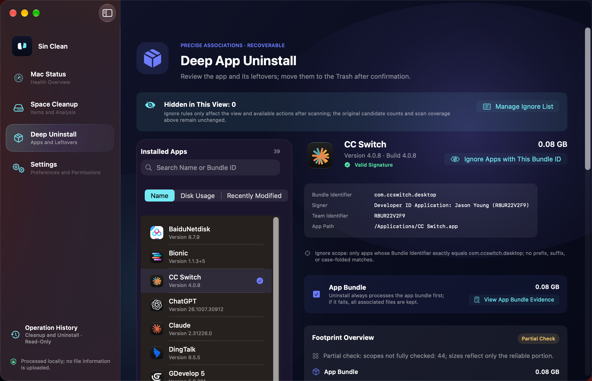
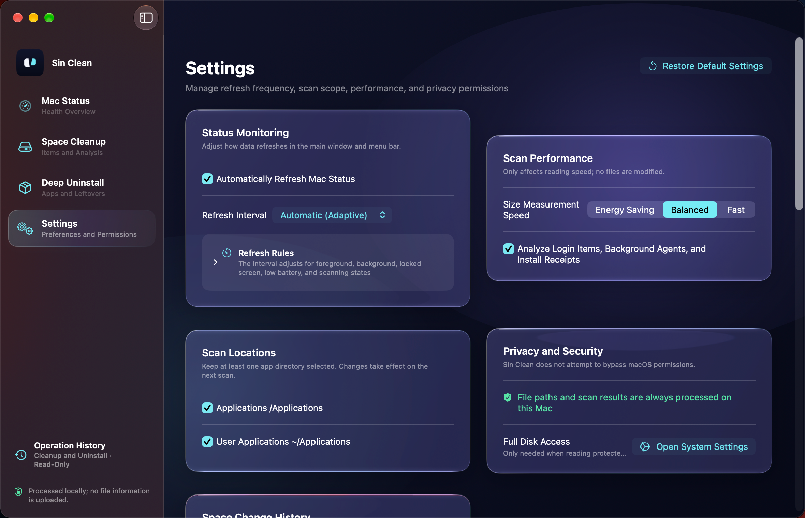
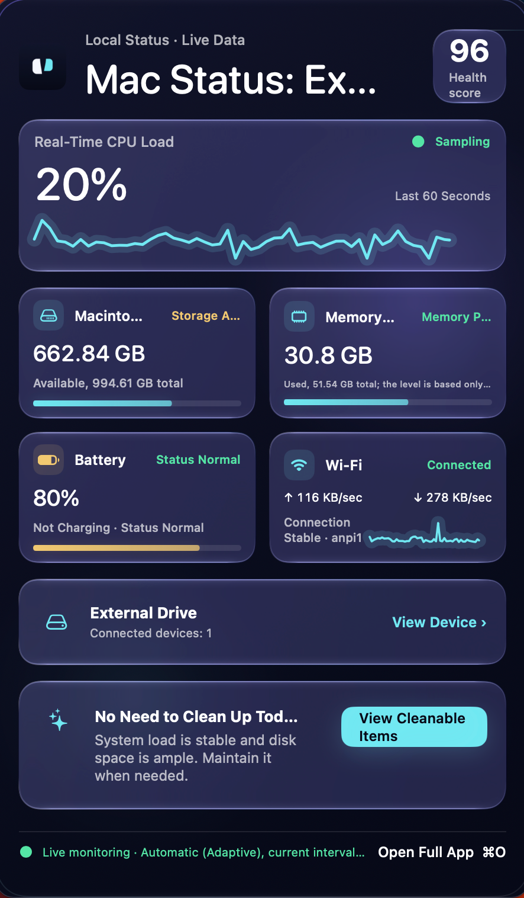

# Sin Clean

A native macOS disk-cleanup utility that respects your privacy: everything runs on-device, with zero file-content uploads.

[中文说明](README.zh-CN.md)

## Screenshots

| Space Analysis — left task card & right results | Mac Status dashboard | Cleanable Items |
| --- | --- | --- |
|  |  |  |

| Deep Uninstall | Settings | Menu Bar Panel |
| --- | --- | --- |
|  |  |  |

## Features

- **Mac Status** — at-a-glance system health dashboard
- **Space Cleanup** — cleanable-item scanning, plus a unified **Space Analysis** workbench: pick scopes and start a scan from the left rail while results, diagnosis and history flow on the right; the scan button stays reachable at any window size
- **Deep Uninstall** — app removal with associated-file detection and full evidence receipts
- **Settings** — preferences, permissions, and manual update checks

## Principles

1. On-device only — no file contents or names ever leave your Mac
2. Read-first analysis — every destructive action requires explicit, per-item confirmation
3. Trash, not delete — removals go to the system Trash and are reversible
4. Signed & notarized — Developer ID signed, notarized builds
5. Verifiable updates — update packages are validated with Ed25519 signatures

## Building

Requires macOS 14.0+ and a full Xcode installation.

```bash
xcodebuild -project SinClean.xcodeproj -scheme SinClean build
```

## Updates

Sin Clean checks for updates only when you ask it to (Settings → About → Check for Updates). Update manifests are Ed25519-signed; packages are verified before installation.

## License

[MIT](LICENSE) © 2026 Di Tian
